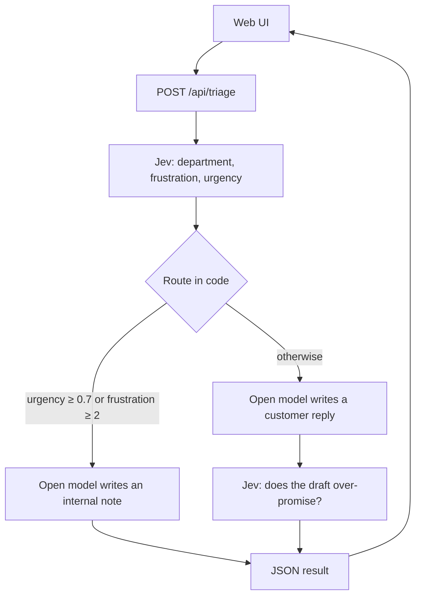

# Support decision workflow

A customer message is classified, routed by application code, and only then written up. The model that writes the reply does not decide what happens to the ticket.

[Jev](https://docs.typesafe.ai) (TypeSafe System One) returns three typed judgments in one call: department, frustration, and urgency. `decideRoute` applies explicit thresholds. An open chat model on the [NVIDIA API Catalog](https://build.nvidia.com/) writes either an internal handoff note or a customer reply from that decision. On the auto-reply path, Jev reads the draft and flags over-promising. The default writer is `openai/gpt-oss-20b`. Override it with `NVIDIA_MODEL`.

[](https://github.com/ravejedii/JEV-Customer-Service-Decision-Workflow/actions/workflows/ci.yml)

## Pipeline



## Routing policy

The cuts live in `backend/src/config.ts`. Changing them does not require changing the writer.

| Condition | Route |
| --- | --- |
| Urgency ≥ 0.7 | Person. Checked first, so a calm but time-critical ticket still escalates. |
| Frustration ≥ 2 | Person. 2 is "very angry" on a 0–2 scale. |
| Both below the cuts | Auto reply, then an over-promise check. Probability ≥ 0.7 holds the draft. The draft is still returned. |
| Score missing, not finite, or outside 0–1 / 0–2 | Person. An unusable classification fails closed. |

Department must be `billing`, `technical`, or `sales`. Any other label is a 502, not a guess.

## Three tickets

The page loads these from `GET /api/samples`. They are chosen so the same pipeline can show both routes.

| Scenario | What to expect |
| --- | --- |
| Stripe Integration Failure | A failing payments integration plus ASAP language. High urgency, internal handoff note. The draft check does not run, because no customer text is sent. |
| Billing Question A | "Where can I download my March invoice?" Calm tone, auto reply, then Jev checks the draft. |
| Billing Question B | The same billing topic in an angry tone. Urgency or frustration should cross a cut and route to a person. |

## Run

Node.js 20 or newer.

```bash
cp .env.example .env
```

Set `TYPESAFE_API_KEY` and `NVIDIA_API_KEY` in that file. Each one has to be its own `KEY=value` line.

```bash
# API
cd backend
npm install
npm run dev
```

```bash
# UI
cd web
npm install
npm run dev
```

Open http://127.0.0.1:5173. Vite proxies `/api` to the API on port 3001. The API binds to `127.0.0.1` only.

## Tests

Routing, the writer prompt, message limits, and the HTTP boundary are tested with no model calls and no API keys:

```bash
cd backend
npm test
npm run typecheck
cd ../web
npm run build
```

CI runs those three commands.

## Configuration

| Variable | Required | Default |
| --- | --- | --- |
| `TYPESAFE_API_KEY` | yes | — |
| `NVIDIA_API_KEY` | yes | — |
| `NVIDIA_BASE_URL` | no | `https://integrate.api.nvidia.com/v1` |
| `NVIDIA_MODEL` | no | `openai/gpt-oss-20b` |
| `NVIDIA_TIMEOUT_MS` | no | `12000` |
| `NVIDIA_MAX_TOKENS` | no | `220` |
| `PORT` | no | `3001` |

Keys are read when a request needs them. `GET /api/health` does not touch either provider.

## Layout

```text
backend/src/config.ts           thresholds and env
backend/src/jev/questions.ts    Jev question definitions
backend/src/jev/triage.ts       classify the customer message
backend/src/jev/check.ts        over-promise check on a draft
backend/src/workflow/route.ts   the policy
backend/src/workflow/run.ts     classify, route, write, maybe check
backend/src/reply/prompt.ts     what the writer is allowed to say
backend/src/reply/nvidia.ts     NVIDIA catalog client
backend/src/server.ts           HTTP API
web/                            Vite timeline UI
docs/architecture.md            why the boundary is drawn this way
```

## Scope

This is a local demo of that boundary, not a support platform.

- There is no auth, persistence, queue, or tenant isolation. Binding to loopback is the access control.
- The over-promise check is a second judgment. It is not a proof the draft is safe to send.
- Customer text is untrusted data in the writer prompt. The instruction to ignore embedded commands is a constraint, not a sandbox.
- Messages longer than 4,000 characters are rejected before any model is called.

How the pieces fit, and what to change first: [docs/architecture.md](docs/architecture.md).

## License

[MIT](LICENSE)
